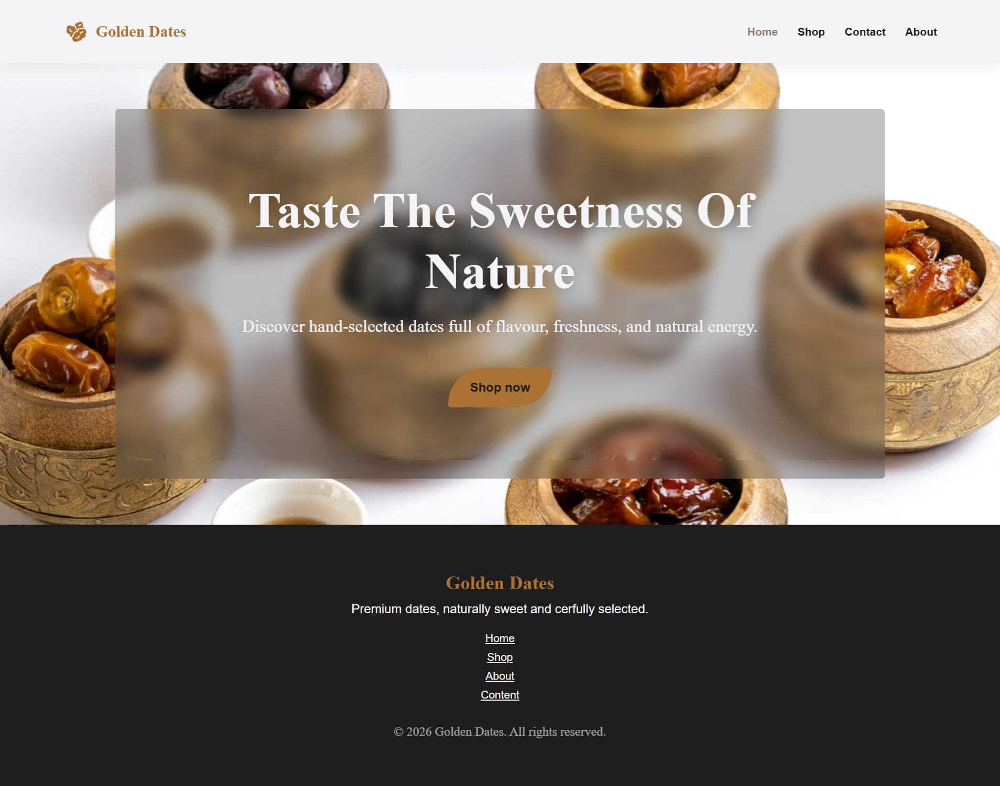

# 🍯 Golden Dates

A modern and elegant landing page for a fictional premium dates brand, designed and developed from scratch with **HTML5 and CSS3**.

The project combines **web development, visual design, and user experience** to create a clean and premium digital presence for a fictional dates brand.



## ✨ Features

* Fixed navigation bar
* Hero section with blurred glassmorphism effect
* Responsive layout structure
* Multi-page website with home and shop pages
* Product-focused shop layout
* Custom typography and visual styling
* Footer with navigation and branding

## 🛠️ Built With


* Semantic HTML5
* CSS3
* Flexbox
* Backdrop Filter
* Figma

## 📂 Project Structure

```text
golden-dates/
├── index.html
├── shop.html
├── style.css
├── img/
└── fonts/
```

## 🚀 Getting Started

Clone the repository:

```bash
git clone https://github.com/aminatre/golden-dates.git
```

Navigate into the project folder:

```bash
cd golden-dates
```

Open `index.html` in your browser or run the project with a local development server such as **Live Server** in VS Code.

No additional setup required.

## 💡 What I Learned

Through this project, I practiced:

* Structuring a multi-page website
* Creating responsive and visually structured layouts
* Working with Flexbox
* Implementing glassmorphism and blur effects
* Writing cleaner and more maintainable CSS
* Improving semantic HTML structure
* Translating a visual design into a functional website

## 🔮 Future Improvements

* Add a responsive mobile navigation
* Add subtle animations and hover interactions
* Improve reusable component patterns
* Expand the shop experience with interactive functionality

📌 Project Status

The project is currently being developed.

The hero section is implemented, with plans to expand the landing page with additional sections.
Future development will focus on expanding the page, refining the visual design, and improving the overall user experience.
